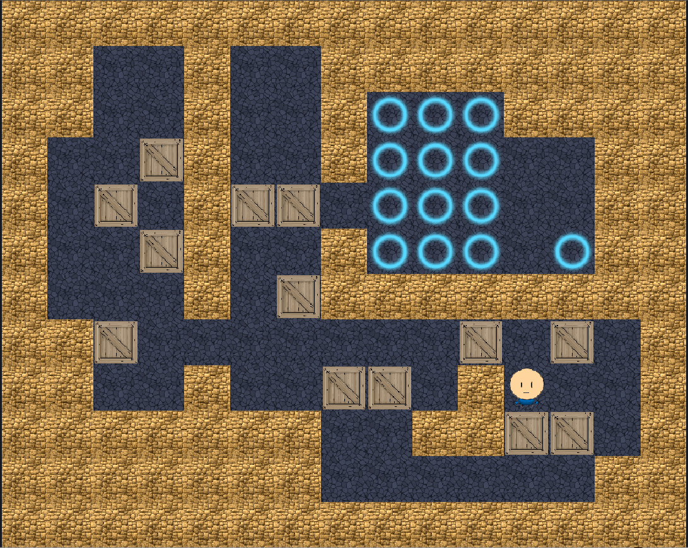
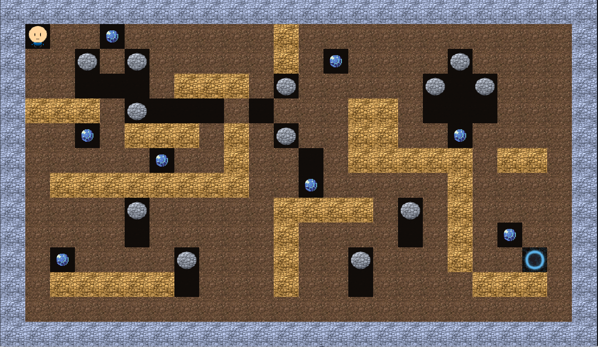

# SokoBoulder

Zwei Rasterspiele in einer nativen macOS-App:

- **Sokoban:** drei Tutorials und 90 Kampagnenlevel, mit Undo/Redo und automatischer
  Wiederaufnahme.
- **Höhle:** ein Boulder-Dash-artiges Echtzeitspiel mit Felsen, Diamanten, Gegnern,
  Explosionen, magischer Wand und Amöbe.

## Herunterladen und spielen

**[Aktuellen Release herunterladen](https://github.com/nox-do/sokoboulder/releases/latest)**

Für **macOS 14 oder neuer**, auf **Apple Silicon und Intel**. Xcode wird zum
Spielen nicht benötigt.

- **DMG:** öffnen und **SokoBoulder** auf **Programme** ziehen. Danach die App
  aus „Programme“ starten.
- **ZIP:** entpacken, `SokoBoulder.app` nach „Programme“ verschieben und dort starten.

### Erster Start: macOS-Freigabe

SokoBoulder ist eine quelloffene Demo, die du selbst bauen kannst. Für dieses
Projekt verzichten wir auf ein kostenpflichtiges Apple-Entwicklerkonto und damit
auf die Notarisierung.

Falls macOS beim ersten Start „Apple konnte nicht überprüfen …“ meldet:

1. **Fertig** klicken.
2. **Systemeinstellungen → Datenschutz & Sicherheit → Sicherheit → Dennoch öffnen** wählen.
3. Mit **Öffnen** bestätigen.

## Screenshots

### Sokoban



### Höhle



## Steuerung

| Taste | Aktion |
| --- | --- |
| Pfeiltasten oder WASD | Bewegen |
| Leertaste | In der Höhle einen Tick warten; in Menüs bestätigen |
| ⌘Z oder Z | Sokoban: Undo |
| ⇧⌘Z | Sokoban: Redo |
| M | Sokoban: Zielmarkierung setzen oder entfernen |
| R oder ⌘R | Level neu starten |
| Escape | Pause beziehungsweise zurück |
| Return oder Leertaste | Markierte Menüaktion ausführen |

## Entwickeln

Die App nutzt SwiftUI, SpriteKit und AVFAudio. Die deterministischen Spielregeln
liegen im lokalen Swift-Package `GameCore`, unabhängig von UI und Rendering.

Voraussetzungen: **Xcode 26.6 / Swift 6.3.3**; für DMG-Packaging zusätzlich
Python 3 mit `venv` und `pip`.

```bash
open MacGameApp.xcodeproj  # In Xcode bauen und starten
./scripts/test.sh         # Stilcheck, GameCore- und App-Tests
./scripts/format.sh       # Swift-Code formatieren
./scripts/lint.sh         # Swift-Stil nur prüfen
```

Universal-App, ZIP und DMG bauen, beispielsweise für Version `0.1.1`:

```bash
./scripts/package-macos.sh 0.1.1
```

Die Pakete landen unter `dist/0.1.1/`. GitHub Actions prüft Pull Requests und
`main`; Release-Tags erzeugen nach Tests einen Release-Entwurf mit Downloads.
Details: [Entwicklung](docs/DEVELOPMENT.md) und [Release-Anleitung](docs/RELEASING.md).

Sokoban und die Höhlen-Demos sind spielbar. Weitere Playtests, Cave-Sand und
Polishing stehen auf der [Aufgabenliste](todo.md).

## Dokumentation

- [GAMEPLAY.md](GAMEPLAY.md): Bedienung und Spielregeln
- [ARCHITECTURE.md](ARCHITECTURE.md): Module und Simulationsverträge
- [AUDIO.md](AUDIO.md): Musik und Effekte
- [Architekturentscheidungen](docs/adr) und [Feature-Pläne](docs/plans)
- [THIRD_PARTY_NOTICES.md](THIRD_PARTY_NOTICES.md): Herkunft und Lizenzen der Assets

## Lizenz

Der eigene Quellcode und die eigene Dokumentation stehen unter der
**[MIT-Lizenz](LICENSE)**. Du darfst sie verwenden, verändern, weitergeben und
verkaufen, auch in geschlossenen oder kommerziellen Projekten. Lizenz- und
Urheberhinweis müssen erhalten bleiben; die Nutzung erfolgt ohne Gewährleistung.

**Drittanbieter-Assets** wie Grafiken, App-Symbol, Musik und Sounds behalten ihre
eigenen Lizenzen, darunter CC0, CC-BY und CC-BY-SA. Sie werden durch die MIT-Lizenz
nicht umgelizenziert. Maßgeblich sind die Hinweise in
[THIRD_PARTY_NOTICES.md](THIRD_PARTY_NOTICES.md) und die dort genannten Lizenztexte.
